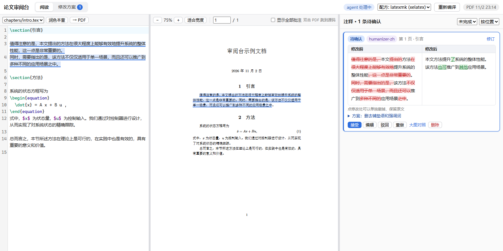

# latex-review-desk · LaTeX 审阅台

本地网页：左边 LaTeX 源码、中间 PDF（双向跳转，像 Overleaf），右边批注栏。
在 PDF 或源码上划词写批注，或选一个 skill（如 humanizer-zh、shuorenhua）请求润色。
请求经 MCP 交给后台 Claude Code / Codex agent 处理，修改方案推回网页，以“修改前 / 修改后”对照显示。
**agent 不直接改源码**，只有你在网页上点“接受”才写入 .tex，写入后可以撤销。



*A local review desk for LaTeX: read PDF and source side by side, annotate or request polishing with any agent skill, let a background agent (via MCP) propose edits, and accept them one by one after a side-by-side diff. Nothing is written to your sources until you accept.*

## 功能

- **直接编辑**：左侧源码可以直接改，停手 1 秒自动保存；Ctrl+S 保存并按顶部选的配方编译，Ctrl+Z 撤销；文件被别的编辑器或接受方案改过时会提示冲突，不会互相覆盖
- **对照阅读**：源码和 PDF 双向跳转（Ctrl+点击源码 / 双击 PDF），按文字精确定位，不只到行
- **批注 / 润色**：PDF 或源码划词，写意见或点一个 skill；“润色本章”对整个文件做
- **逐段润色**：把选区或整章拆成正文段（公式、图表、标题、注释自动跳过），一段一段交给 agent，每段单独确认；可暂停、继续、取消
- **对照确认**：方案按文档中出现的顺序列在侧栏，左右对照、红删绿增，附“理由与收益”“保真复核”；可接受、编辑后接受、驳回、带意见重做或换 skill 重做；点某一处修改可以单独撤掉、保留原文
- **安全写入**：接受时校验原文仍逐字存在，否则标“原文已改”、拒绝写入；保留文件原有换行（CRLF/LF）和 BOM；每次写入都能撤销
- **编译**：选择编译配方（写法与 LaTeX Workshop 的 `latex.recipes` 相同），按 Ctrl+S 或“重新编译”，可终止，出错行可点击跳转

## 安装

需要 Node 22.13+，以及带 `synctex` 的 TeX 发行版（TeX Live / MiKTeX）。

```bash
git clone https://github.com/LuweiLiao/latex-review-desk.git
cd latex-review-desk
npm install                          # 会顺带构建前端
cp config.example.json config.json   # 改成你的 LaTeX 项目路径、主文件、PDF 文件名
npm start                            # 打开 http://127.0.0.1:4317/
```

想先试试：在 `examples/demo` 里用 `latexmk -xelatex -synctex=1 main.tex` 编译一次，再 `npm run demo`，打开 http://127.0.0.1:4318/。

### 接上 agent

1. 注册 MCP（服务名用 `thesis-review`，skill 里按这个名字调用工具）：

   ```bash
   # Claude Code
   claude mcp add --transport http -s user thesis-review http://127.0.0.1:4317/mcp
   # Codex
   codex mcp add thesis-review --url http://127.0.0.1:4317/mcp
   ```

   Codex 建议在 `~/.codex/config.toml` 的 `[mcp_servers.thesis-review]` 下加 `tool_timeout_sec = 600.0`，避免长等待被截断。

2. 安装后台 agent 的 skill（二选一）：

   ```
   /plugin install latex-review-desk --marketplace LuweiLiao/latex-review-desk
   ```

   或者把 `skills/thesis-review-agent` 复制到 `~/.claude/skills/`（Codex 用户复制到 `~/.codex/skills/` 或直接让它读这个 SKILL.md）。

3. 在你的 LaTeX 项目目录里开一个 Claude Code 会话，输入 `/thesis-review-agent`，它会一直等网页上的请求。
   也可以无窗口运行，只给读文件和本 MCP 的权限：

   ```bash
   claude -p "/thesis-review-agent" --allowedTools "Read,Grep,Glob,Skill,mcp__thesis-review"
   ```

4. 润色用的 skill 放在 `~/.claude/skills/`（`config.json` 的 `skillDirs` 可加别的目录），网页会自动列出。
   常用的几个写进 `favoriteSkills`，划词菜单里直接显示成按钮。推荐：
   [humanizer-zh](https://github.com/dake2482/humanizer-zh)、
   [shuorenhua](https://github.com/MrGeDiao/shuorenhua)、
   [stop-slop](https://github.com/hardikpandya/stop-slop)、
   [humanizer](https://github.com/blader/humanizer)。

## 用法

| 操作 | 方式 |
|---|---|
| 批注 / 润色 | 选中文字 → 浮出菜单 →“批注”写意见，或点 skill 按钮；“更多 skill…”可选全部 |
| 逐段润色 | 润色表单里勾“逐段润色”，可选同时交给 agent 1～3 段 |
| 润色本章 | 源码栏“润色本章”，默认逐段 |
| 源码 ↔ PDF | Ctrl+点击源码或点“→ PDF”；双击 PDF 跳回源码 |
| 确认方案 | 侧栏卡片上接受 / 编辑 / 驳回 / 重做；点修改处单独撤掉；“大图对照”看完整段落 |
| 误点驳回 | 筛选“已驳回”，点“恢复方案” |
| 撤销写入 | 已接受的卡片点“撤销写入” |
| 按章看注释 | 侧栏顶部选章：默认跟随左侧打开的那一章，也可选“全部章节”（按章分组）或指定某一章；选项里标着各章待确认条数 |
| 刷新网页 | 回到上次的位置：打开的文件、源码滚动和光标（每个文件各记一份）、PDF 页码和页内位置、选中的批注、侧栏滚动、当前页签 |
| 只看当前批注 | 默认只高亮选中的那条；勾“显示全部批注”看其他的；Esc 取消选中 |

## 配置

`config.json`（相对路径按本工具目录解析）：

| 字段 | 说明 |
|---|---|
| `projectRoot` / `mainTex` / `pdf` | LaTeX 项目目录、主文件、输出 PDF |
| `sourceDirs` / `extraSources` | 网页能读写的 .tex 范围，范围外的文件一律拒绝 |
| `tools` / `recipes` / `defaultRecipe` | 编译工具和配方；占位符 `%DOCFILE%` 主文件名、`%DOC%` 去掉 .tex、`%JOBNAME%` PDF 去掉 .pdf。工具参数要带 `-synctex=1` |
| `skillDirs` / `defaultSkill` / `favoriteSkills` | skill 目录、默认 skill、划词菜单里的常用按钮 |
| `claimTimeoutMin` | agent 领取后多久没交方案就放回队列 |
| `waitTimeoutSec` | `wait_for_requests` 默认等待秒数 |

## MCP 工具

| 工具 | 作用 |
|---|---|
| `wait_for_requests(max, timeout_sec)` | 阻塞等待并领取请求：选中原文、前后 15 行源码、所在段落、章节、所选 skill、处理说明、对话记录和之前被驳回的方案 |
| `submit_proposal(id, edits, rationale, fidelity, summary)` | 提交方案；`original` 必须逐字存在于源码，否则报错让 agent 修正 |
| `reply(id, message)` | 只回复不改文字（提问、或这段无需修改） |
| `list_requests` / `get_request` / `get_skill` | 查询 |

## 说明

- 只监听 127.0.0.1，并校验 Host / Origin。
- 批注和方案保存在 `data/state.json`，已在 `.gitignore` 里。
- 测试：`npm test`；MCP 冒烟测试：`npm run smoke`（会领取一条真实请求并提交一个测试方案）。

## License

MIT
