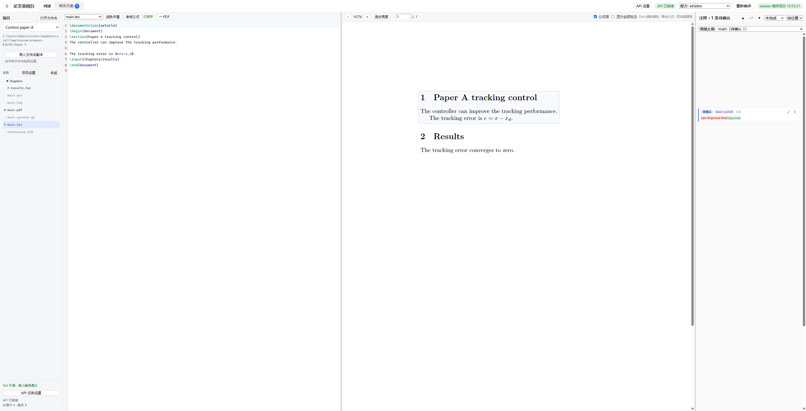

# latex-review-desk · LaTeX 审阅台

本地网页：左边 LaTeX 源码、中间 PDF（双向跳转，像 Overleaf），右边批注栏。
在 PDF 或源码上划词写批注，或选一个 skill（如 humanizer-zh、shuorenhua）请求润色。
可在网页中配置 AI API 直接处理请求，也可经 MCP 交给后台 Claude Code / Codex agent。修改方案以“修改前 / 修改后”对照显示。
**AI 提交修改方案**，只有你在网页上点“接受”才写入 .tex，写入后可以撤销。



*A local review desk for multiple LaTeX projects: read PDF and source side by side, annotate or request polishing through direct OpenAI, Anthropic or Gemini APIs, and accept proposed edits after a side-by-side diff. MCP agents are also supported. AI proposals are written to your sources only after you accept.*

## 功能

- **直接编辑**：左侧源码可以直接改，停手 1 秒自动保存；Ctrl+S 保存并按顶部选的配方编译，Ctrl+Z 撤销；文件被别的编辑器或接受方案改过时会提示冲突，不会互相覆盖
- **对照阅读**：源码和 PDF 双向跳转（Ctrl+点击源码 / 双击 PDF），按文字精确定位，不只到行
- **批注 / 润色**：PDF 或源码划词，写意见或点一个 skill；“润色本章”对整个文件做
- **逐段润色**：把选区或整章拆成正文段（公式、图表、标题、注释自动跳过），一段一段交给 agent，每段单独确认；可暂停、继续、取消
- **贴边卡片**：注释像 Overleaf / Word 批注那样贴在 PDF 对应文字的高度，跟着 PDF 滚动；小卡片只显示改了哪几个字和 ✓ / ✗，点开在原位展开成完整对照；卡片栏有自己的滚动条，和 PDF 双向同步；顶部 ▲ / ▼ 在注释之间跳上一处 / 下一处（按时间排序时是普通列表）
- **对照确认**：方案按文档中出现的顺序列在侧栏，左右对照、红删绿增，附“理由与收益”“保真复核”；可接受、编辑后接受、驳回、带意见重做或换 skill 重做；点某一处修改可以单独撤掉、保留原文
- **改动标黄**：接受后写入的文字在源码和 PDF 上标浅黄（只标改了的字，只删的地方留小黄点），顶栏“确认修改”或卡片上的“确认”去掉标黄
- **安全写入**：接受时校验原文仍逐字存在，否则标“原文已改”、拒绝写入；保留文件原有换行（CRLF/LF）和 BOM；每次写入都能撤销
- **编译**：选择编译配方（写法与 LaTeX Workshop 的 `latex.recipes` 相同），按 Ctrl+S 或“重新编译”，可终止，出错行可点击跳转

## 安装

需要 Node 22.13+。编译和源码/PDF 跳转需要带 `synctex` 的 TeX 发行版（TeX Live / MiKTeX）；没有安装 TeX 时也可以启动网页、管理项目和设置 AI。

### 从 GitHub 安装（推荐）

使用 npm 直接安装 GitHub Release 中已经构建的软件包。无需克隆源码、构建前端或登录 npm 账户。

```bash
npm install -g "https://github.com/LuweiLiao/latex-review-desk/releases/download/v0.3.0/latex-review-desk-0.3.0.tgz"
latex-review-desk /path/to/latex-project
```

启动后自动打开浏览器，默认地址为 `http://127.0.0.1:4317/`。不传项目路径时使用当前目录；主文件默认为 `main.tex`，可在网页中选择或通过参数指定。安装包带有已经构建的前端和 PDF.js 文件，安装时不运行前端构建，也不需要安装开发依赖。当前通过 GitHub Release 分发，不使用尚未发布的 `npm install -g latex-review-desk` 命令。

Windows 示例：

```powershell
latex-review-desk "D:/papers/my thesis" --port 4320
```

也可从 Release 下载 `latex-review-desk-0.3.0.tgz`，在下载目录中安装：

```powershell
npm install -g ./latex-review-desk-0.3.0.tgz
```

更新时安装新版本 Release 对应的地址；卸载使用 `npm uninstall -g latex-review-desk`。

```bash
latex-review-desk "D:/papers/my thesis" --main master.tex --pdf master.pdf --port 4320
latex-review-desk --config /path/to/config.json --no-open
latex-review-desk --diagnose
latex-review-desk --check-compile --engine xelatex
```

`--diagnose` 输出 TeX Live / MiKTeX 版本，以及编译器、latexmk、BibTeX、Biber、SyncTeX 的路径和版本。`--check-compile` 只编译系统临时目录中新建的最小文档，检查 PDF 和 SyncTeX 输出后删除临时文件，不编译当前项目。没有指定引擎时依次查找 pdflatex、xelatex、lualatex。检测和编译检查在同一进程中缓存 60 秒，`--refresh` 可重新检查；版本查询最多等待 8 秒，临时编译最多等待 30 秒。

完整参数见 `latex-review-desk --help`：`--project`、`--config`、`--config-dir`、`--data-dir`、`--port`、`--main`、`--pdf`、`--no-open`、`--diagnose`、`--check-compile`、`--engine`、`--refresh`。

### 从源码运行

```bash
git clone --branch v0.3.0 https://github.com/LuweiLiao/latex-review-desk.git
cd latex-review-desk
npm ci
npm run build
npm start -- /path/to/latex-project
```

想先试试：在 `examples/demo` 里用 `latexmk -xelatex -synctex=1 main.tex` 编译一次，再 `npm run demo`，打开 http://127.0.0.1:4318/。自己的配置可从 `config.example.json` 复制；用 `--config` 明确指定配置文件。

发布前运行 `npm pack` 会构建压缩前端。包中只包含运行所需的服务端、CLI、前端、PDF.js、agent skills、配置示例和许可证；实际 `config.json`、审阅数据、开发文档、测试和密钥文件不在发布范围内。

### 用户目录

配置、项目登记和 AI 设置保存在全局用户配置目录。命令行首次打开项目时，默认审阅数据位置如下：

| 系统 | 默认配置目录 | 默认数据目录 |
|---|---|---|
| Windows | `%APPDATA%/latex-review-desk` | `%LOCALAPPDATA%/latex-review-desk/projects/<项目路径摘要>` |
| macOS | `~/Library/Application Support/latex-review-desk` | `~/Library/Application Support/latex-review-desk/projects/<项目路径摘要>` |
| Linux | `$XDG_CONFIG_HOME/latex-review-desk`，默认 `~/.config/latex-review-desk` | `$XDG_DATA_HOME/latex-review-desk/projects/<项目路径摘要>`，默认 `~/.local/share/latex-review-desk/projects/<项目路径摘要>` |

`--config-dir` 和 `--data-dir` 可覆盖这些目录。对应环境变量为 `THESIS_REVIEW_CONFIG_DIR`、`THESIS_REVIEW_DATA_DIR`；项目和启动选项还可用 `THESIS_REVIEW_CONFIG`、`THESIS_REVIEW_PROJECT`、`THESIS_REVIEW_PORT`、`THESIS_REVIEW_MAIN_TEX`、`THESIS_REVIEW_PDF` 设置。显式命令行参数优先。通过 `--config` 加载旧配置时沿用其数据位置，不把已有审阅记录移到新目录。

网页中添加的项目，其配置和审阅数据保存在 `<配置目录>/projects/<项目 ID>/config.json` 和 `<配置目录>/projects/<项目 ID>/data/`；目录导入的副本保存在同一项目目录的 `source/` 中。项目登记表为 `<配置目录>/projects/projects.json`，AI 设置为 `<配置目录>/ai-settings.json`。再次打开已登记的项目时沿用该项目原来的数据位置。

本次实际运行验证使用 Windows、Node 22.19.0 和 TeX Live 2025；macOS/Linux 目录和浏览器命令有单元测试，尚未在对应系统实机验证。

### 配置 AI

右上角“Agent 设置”可以保存多组 Agent。每组分别配置名称、接口格式、API 地址、模型、密钥、提示词和同时处理数量，支持 OpenAI Chat Completions、OpenAI Responses、Anthropic 和 Gemini。各组配置独立保存，切换 Agent 不会覆盖其他组的模型或密钥。

顶部下拉框选择默认 Agent；设置窗口底部可以为正文润色、批注回复和公式审核分别指定 Agent。选择“使用默认 Agent”的任务跟随顶部选择。各条处理结果会显示实际使用的 Agent 名称。原来的单组 API 设置会自动作为默认 Agent 读取。

“打开文件夹”直接调用操作系统的文件夹选择窗口，选择后使用原目录；“导入文件夹副本”仍将上传或拖入的文件夹复制到工具管理目录。Windows 使用系统原生文件夹选择器，macOS 使用系统选择器，Linux 使用 zenity；无法打开原生窗口时可手动输入路径。

项目的写作要求可保存在项目设置中。密钥保存在用户配置目录，不随安装包分发。

### 接上 MCP agent

需要使用 Claude Code / Codex agent 时，可按下面的步骤连接 MCP：

1. 注册 MCP（服务名用 `thesis-review`，skill 里按这个名字调用工具）：

   ```bash
   # Claude Code
   claude mcp add --transport http -s user thesis-review http://127.0.0.1:4317/mcp
   # Codex
   codex mcp add thesis-review --url http://127.0.0.1:4317/mcp
   ```

   Codex 建议在 `~/.codex/config.toml` 的 `[mcp_servers.thesis-review]` 下加 `tool_timeout_sec = 600.0`，避免长等待被截断。

2. 安装后台 agent 的 skill（二选一）：

   ```
   /plugin install latex-review-desk --marketplace LuweiLiao/latex-review-desk
   ```

   或者把 `skills/thesis-review-agent` 复制到 `~/.claude/skills/`（Codex 用户复制到 `~/.codex/skills/` 或直接让它读这个 SKILL.md）。

3. 在你的 LaTeX 项目目录里开一个 Claude Code 会话，输入 `/thesis-review-agent`，它会一直等网页上的请求。
   也可以无窗口运行，只给读文件和本 MCP 的权限：

   ```bash
   claude -p "/thesis-review-agent" --allowedTools "Read,Grep,Glob,Skill,mcp__thesis-review"
   ```

   公式审核另开一个 agent，用 `skills/thesis-formula-review`：它只领公式审核请求（`wait_for_requests(kinds=["formula"])`），和处理批注、润色的 agent 互不干扰。

4. 润色用的 skill 放在 `~/.claude/skills/`（`config.json` 的 `skillDirs` 可加别的目录），网页会自动列出。
   常用的几个写进 `favoriteSkills`，划词菜单里直接显示成按钮。推荐：
   [humanizer-zh](https://github.com/dake2482/humanizer-zh)、
   [shuorenhua](https://github.com/MrGeDiao/shuorenhua)、
   [stop-slop](https://github.com/hardikpandya/stop-slop)、
   [humanizer](https://github.com/blader/humanizer)。

## 用法

| 操作 | 方式 |
|---|---|
| 批注 / 润色 | 选中文字 → 浮出菜单 →“批注”写意见，或点 skill 按钮；“更多 skill…”可选全部 |
| 逐段润色 | 润色表单里勾“逐段润色”，可选同时交给 agent 1～3 段 |
| 润色本章 | 源码栏“润色本章”，默认逐段 |
| 源码 ↔ PDF | Ctrl+点击源码或点“→ PDF”；双击 PDF 跳回源码 |
| 缩放 PDF | Ctrl+滚轮（触摸板双指捏合）以鼠标处为中心缩放；也可用 PDF 栏的 −、+、适合宽度 |
| 确认方案 | 侧栏卡片上接受 / 编辑 / 驳回 / 重做；点修改处单独撤掉；“大图对照”看完整段落 |
| 误点驳回 | 筛选“已驳回”，点“恢复方案” |
| 撤销写入 | 已接受的卡片点“撤销写入” |
| 按章看注释 | 侧栏顶部选章：默认跟随左侧打开的那一章，也可选“全部章节”（按章分组）或指定某一章；选项里标着各章待确认条数 |
| 刷新网页 | 回到上次的位置：打开的文件、源码滚动和光标（每个文件各记一份）、PDF 页码和页内位置、选中的批注、侧栏滚动、当前页签 |
| 筛选 | 默认“未完成”：待处理、处理中、待确认和 agent 对批注的回复；已接受、已驳回、逐段润色里“无需修改”的回复在各自的筛选里 |
| 公式框 | PDF 上的公式自动加框（只画在网页上，不改 PDF）；单击公式可批注、润色或“审核这个公式”，左侧源码同时跳到这个公式；PDF 栏“公式框”取消勾选后只在悬停时显示 |
| 审核公式 | 源码栏“审核公式”：本章或全文，按顺序一个一个审核独立公式（符号定义、维数、上下标、推导衔接、编号引用）；结论分通过 / 有问题 / 拿不准，“通过”的不挂在未完成里，侧栏筛选“公式审核”看全部 |
| 只看当前批注 | 默认只高亮选中的那条；勾“显示全部批注”看其他的；Esc 取消选中 |

## 配置

`--config` 指定的配置文件中，相对项目路径按配置文件所在目录解析；命令行项目路径按启动时的当前目录解析：

| 字段 | 说明 |
|---|---|
| `projectRoot` / `mainTex` / `pdf` | LaTeX 项目目录、主文件、输出 PDF |
| `sourceDirs` / `extraSources` | 网页能读写的 .tex 范围，范围外的文件一律拒绝 |
| `tools` / `recipes` / `defaultRecipe` | 编译工具和配方；占位符 `%DOCFILE%` 主文件名、`%DOC%` 去掉 .tex、`%JOBNAME%` PDF 去掉 .pdf。工具参数要带 `-synctex=1` |
| `skillDirs` / `defaultSkill` / `favoriteSkills` | skill 目录、默认 skill、划词菜单里的常用按钮 |
| `claimTimeoutMin` | agent 领取后多久没交方案就放回队列 |
| `waitTimeoutSec` | `wait_for_requests` 默认等待秒数 |

## MCP 工具

| 工具 | 作用 |
|---|---|
| `wait_for_requests(max, timeout_sec)` | 阻塞等待并领取请求：选中原文、前后 15 行源码、所在段落、章节、所选 skill、处理说明、对话记录和之前被驳回的方案 |
| `submit_proposal(id, edits, rationale, fidelity, summary)` | 提交方案；`original` 必须逐字存在于源码，否则报错让 agent 修正 |
| `reply(id, message)` | 只回复不改文字（提问、或这段无需修改） |
| `list_requests` / `get_request` / `get_skill` | 查询 |

## 说明

- 只监听 127.0.0.1，并校验 Host / Origin。
- 批注和方案保存在所选数据目录的 `state.json`；旧配置继续使用原数据目录。
- 测试：`npm test`；MCP 冒烟测试：`npm run smoke`（会领取一条真实请求并提交一个测试方案）。

## License

MIT
